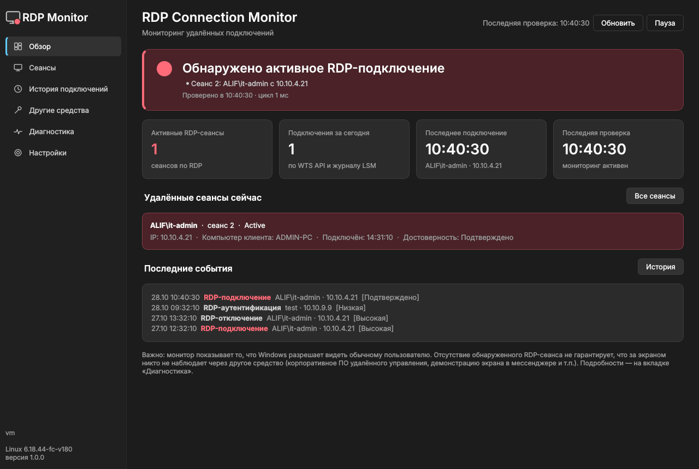

# RDP Connection Monitor

Переносимое приложение для Windows 10/11, которое показывает, подключён ли кто-то к компьютеру
по RDP, и уведомляет о новых подключениях, отключениях и теневом подключении к сеансу.
Работает **от обычного пользователя**: без установки, без UAC, без служб, без интернета.



*Скриншоты сделаны на тестовых данных (`tools/render_preview.py`); в рабочем режиме тестовые данные не используются.*

## Возможности

* **Активные RDP-сеансы** через WTS API: пользователь, Session ID, состояние (Active / Connected /
  Disconnected), IP и имя компьютера клиента, время входа/подключения.
* **Новые подключения, переподключения, отключения, завершения сеансов** — сравнением состояний каждые
  2 секунды (1–30 с, настраивается) + мгновенная проверка по системному событию `WM_WTSSESSION_CHANGE`.
* **Журналы Windows** (если доступны): TerminalServices LocalSessionManager (21–25, 39),
  RemoteConnectionManager (1149, 261, теневые 20503–20513), Security (4624/4634 тип 10, 4647, 4778, 4779).
* **Корреляция и уровень достоверности**: «Подтверждено / Высокая / Средняя / Низкая / Информация».
  Event 1149 без входа в сеанс остаётся «Низкая».
* **TCP-соединения с RDP-портом** — IP удалённого компьютера виден даже до входа в сеанс.
* **Теневое подключение (RDP Shadow)** к вашему сеансу: `SM_REMOTECONTROL`, процессы RdpSa*, события журнала.
* **Другие средства удалённого доступа**: AnyDesk, TeamViewer, RustDesk, Chrome Remote Desktop, VNC,
  Quick Assist, msra, SCCM Remote Control и др. — с явным разделением «обнаружена / процесс запущен /
  подключение подтверждено / статус неизвестен». Запуск процесса **не** считается подключением.
* **Три состояния**: 🔴 подключение обнаружено · 🟢 подключений не обнаружено · 🟡 недостаточно данных.
* **Уведомления Windows** + звук, без повторов на каждом цикле, с отключаемыми категориями;
  сводка «пока ваш сеанс был отключён».
* **Трей**: зелёный / красный / жёлтый / серый значок, меню, работа в фоне при закрытом окне.
* **История** в SQLite (`%LOCALAPPDATA%\RDPConnectionMonitor\history.db`), поиск, фильтры, экспорт CSV/JSON,
  автоочистка (по умолчанию 30 дней).
* **Диагностика** доступности каждого источника с понятными объяснениями и копированием отчёта.
* Тёмная тема в стиле Windows 11, поддержка высокого DPI, русский интерфейс, защита от второго экземпляра.

Подробно об ограничениях — [docs/LIMITATIONS.md](docs/LIMITATIONS.md).

## Запуск на целевом компьютере

1. Скопируйте `RDPConnectionMonitor.exe` в любую папку, доступную вам (например, `Документы\Tools`).
2. Запустите двойным щелчком. Права администратора и установка не нужны.
3. Закрытие окна сворачивает приложение в трей; выход — через меню значка в трее.

Ключи командной строки:

| Ключ | Назначение |
|---|---|
| `--minimized` | запуск сразу в трей (удобно для ярлыка в `shell:startup`) |
| `--probe` | без интерфейса: снимок всех источников в `%LOCALAPPDATA%\RDPConnectionMonitor\probe.json` и `probe.txt` |

Автозапуск без прав администратора: `Win+R` → `shell:startup` → положите туда ярлык на EXE с ключом `--minimized`.

### Первая проверка на вашем ноутбуке

Код Windows API написан по документации Microsoft, но в среде разработки проверялся только на
подставных данных. На реальном ПК сделайте один раз:

1. Запустите `RDPConnectionMonitor.exe --probe` и откройте `%LOCALAPPDATA%\RDPConnectionMonitor\probe.txt` —
   там видно, какие источники доступны вашей учётной записи.
2. Откройте вкладку **Диагностика** → «Копировать диагностическую информацию».
3. Если есть возможность — попросите коллегу подключиться по RDP (или подключитесь сами с другого ПК)
   и проверьте, что появились красный статус, уведомление и запись в истории.

## Сборка EXE (на машине разработчика, Windows)

Требуется Python 3.12+.

```bat
build.bat            :: тесты + dist\RDPConnectionMonitor.exe (один файл, --onefile --windowed)
build.bat onedir     :: папочная сборка, если AppLocker запрещает запуск из %TEMP%
```

Вручную:

```bat
py -3.12 -m venv .venv
.venv\Scripts\activate
pip install -r requirements-dev.txt
python -m pytest -q
pyinstaller --noconfirm --clean rdp_monitor.spec
```

### Сборка в GitHub Actions (без Windows-машины)

Workflow [`.github/workflows/build-windows.yml`](.github/workflows/build-windows.yml) на `windows-latest`:
тесты → `--probe` на реальной Windows → `RDPConnectionMonitor.exe` (onefile) и `RDPConnectionMonitor-onedir.zip`
→ проверка манифеста `asInvoker` и пробный запуск собранного EXE → SHA-256.

* **push в `main`** / pull request / ручной запуск (Actions → Build Windows EXE → Run workflow) —
  файлы в разделе *Artifacts* запуска (хранятся 30 дней);
* **тег версии** — дополнительно GitHub Release с EXE:

  ```bash
  git tag v1.0.0 && git push origin v1.0.0
  ```

PyInstaller-сборка: `--onefile`, `--windowed`, манифест [`rdp_monitor.manifest`](rdp_monitor.manifest)
с `requestedExecutionLevel level="asInvoker"`, `uac_admin=False`, Per-Monitor V2 DPI, UPX выключен
(меньше ложных срабатываний антивирусов). Значок и свойства файла — `assets/icons/app.ico`, `version_info.txt`.

> На управляемых ПК неподписанный EXE может блокироваться SmartScreen, AppLocker/WDAC или EDR.
> Это политика организации; приложение её не обходит. В таком случае согласуйте запуск с ИТ/ИБ.

## Запуск из исходников

```bat
pip install -r requirements.txt
python main.py
```

## Тесты

```bash
pip install -r requirements-dev.txt
QT_QPA_PLATFORM=offscreen python -m pytest -q      # Windows: set QT_QPA_PLATFORM=offscreen
```

Покрыты сценарии из ТЗ: запуск без повышения прав (манифест, отсутствие опасных вызовов),
нет подключений → зелёный статус, новая сессия → событие и уведомление, отключение → событие в БД,
недоступный Security log → работа продолжается, сворачивание в трей → мониторинг идёт,
второй экземпляр → активирует первый, AnyDesk → «программа обнаружена», но без заявления о подключении.
Плюс разбор XML событий, корреляция 1149, дедупликация уведомлений, разбор `query user` (EN/RU),
журналы AnyDesk/TeamViewer, пауза мониторинга.

## Структура

```
main.py                     точка входа (+ --probe)
app/       config.py        настройки, пути %LOCALAPPDATA%
           application.py   сборка приложения, связи сигналов
           monitor_worker.py фоновый QThread, восстановление после ошибок
           single_instance.py
core/      winapi.py        ctypes: WTS API, GetSystemMetrics, ProcessIdToSessionId
           wts_monitor.py   сеансы (WTS API, резерв — query user)
           session_manager.py сравнение состояний → события
           eventlog_monitor.py wevtapi (ctypes): чтение и разбор журналов
           network_monitor.py TCP-соединения с RDP-портом, настройки RDP (чтение)
           correlation.py   корреляция источников, достоверность
           connection_detector.py цикл мониторинга, итоговый статус
           remote_tools_detector.py AnyDesk/TeamViewer/… (процессы, журналы программ)
           diagnostics.py   проверка доступности источников
gui/       main_window.py, dashboard.py, sessions_view.py, history_view.py,
           remote_tools_view.py, diagnostics_view.py, settings_view.py, tray_manager.py, theme.py, widgets.py
services/  storage.py (SQLite), notifications.py, logger.py
tests/     test_session_detection.py, test_event_correlation.py, test_notifications.py, test_app.py
tools/     make_icons.py, render_preview.py (только для разработки)
```

## Данные и приватность

Всё хранится локально: `%LOCALAPPDATA%\RDPConnectionMonitor\` (`history.db`, `settings.json`, `logs\app.log`).
Приложение не обращается к сети.
